


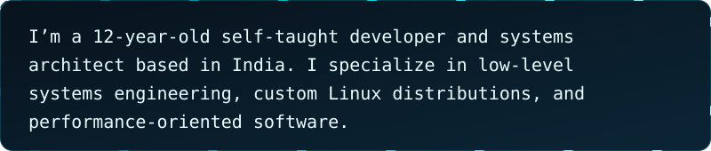

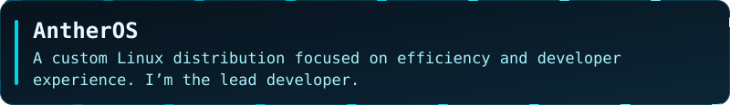
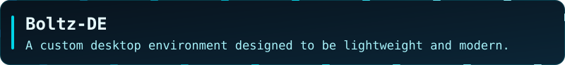
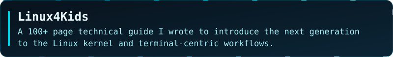
<a href="https://github.com/anagh9090/AntherListen">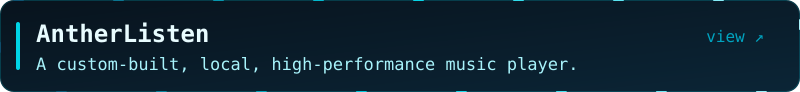</a>
<a href="https://github.com/anagh9090/AntherListen-Online">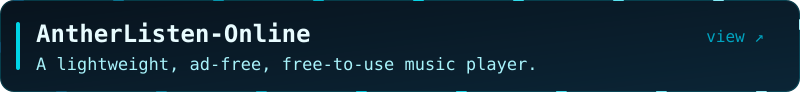</a>
<a href="https://tinyurl.com/AntherAI">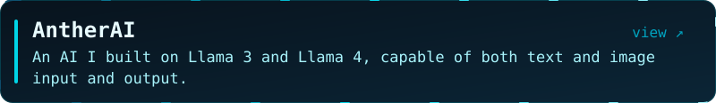</a>
<a href="https://github.com/anagh9090/AntherClient">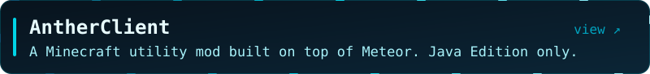</a>

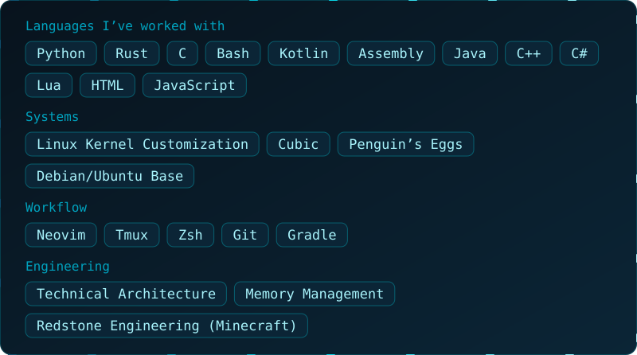

  
  

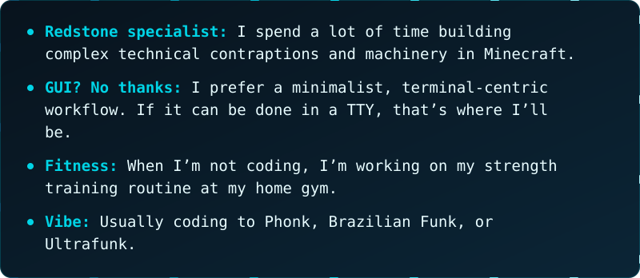

<a href="https://antheros.org">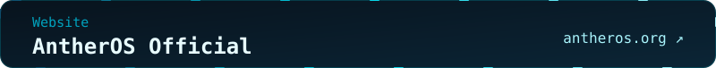</a>
<a href="https://github.com/AntherOS-Technologies">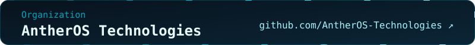</a>

